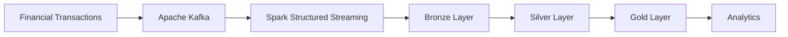

# Real-Time Financial Data Platform

A real-time financial data processing platform built with **Apache Kafka, Apache Spark Structured Streaming, Databricks and Delta Lake**, following the Medallion Architecture to organize financial transaction data into Bronze, Silver and Gold layers.

The project explores distributed data ingestion, stream processing, data transformation and lakehouse architecture.

---

## Overview

This project aims to build a scalable data pipeline for processing financial transactions using modern Big Data technologies.

The platform is designed to ingest transaction events through Apache Kafka, process them using Apache Spark, and organize the data within a Delta Lake architecture following the Medallion pattern.

The objective is to explore the fundamentals of real-time data engineering, from event ingestion to structured data storage and analytics-ready datasets.

## Architecture



The pipeline follows a Medallion Architecture:

- **Bronze:** Raw financial transaction data ingested from the source.
- **Silver:** Cleaned, validated and transformed transaction data.
- **Gold:** Aggregated and structured data prepared for analytics and reporting.

## Technologies

| Technology | Role |
|---|---|
| Apache Kafka | Event ingestion and message streaming |
| Apache Spark | Distributed data processing |
| Spark Structured Streaming | Stream processing framework |
| Databricks | Spark development and execution environment |
| Delta Lake | Reliable lakehouse storage |
| Docker | Containerized Kafka environment |
| Python | Data processing and development |

## Pipeline Components

### 1. Data Ingestion — Apache Kafka

Apache Kafka is used as the messaging system for financial transaction events.

The Kafka environment was deployed locally using Docker, with the following configuration:

- **Docker image:** `apache/kafka:4.3.1`
- **Container:** `financial-kafka`
- **Port:** `9092`
- **Topic:** `financial-transactions`
- **Partitions:** 3
- **Replication factor:** 1

Kafka provides the foundation for event-driven data ingestion and enables the pipeline to handle transaction events through a distributed messaging system.

### 2. Stream Processing — Apache Spark

Apache Spark Structured Streaming is the processing framework selected for handling transaction data.

The processing layer is designed to consume events, apply data transformations and prepare structured datasets for storage within the lakehouse.

Spark provides distributed processing capabilities to support scalable data processing workloads.

### 3. Lakehouse Storage — Delta Lake

Delta Lake is used as the storage layer for organizing processed data.

The data organization follows the Medallion Architecture:

| Layer | Description |
|---|---|
| Bronze | Raw transaction data |
| Silver | Cleaned and transformed data |
| Gold | Aggregated datasets for analytics |

This layered approach improves data organization, traceability and the separation of processing stages.

### 4. Databricks Environment

Databricks was used as the Spark processing environment.

The project was developed and explored using Databricks Free Edition, with Spark 4.2.0.

The environment was used to explore distributed processing and lakehouse transformations with Spark and Delta Lake.

## Project Implementation

The project involved:

- Setting up a local Kafka environment using Docker.
- Creating and configuring the `financial-transactions` Kafka topic.
- Exploring event ingestion through Kafka.
- Working with Apache Spark in Databricks.
- Exploring Spark Structured Streaming for transaction processing.
- Structuring data processing according to the Bronze, Silver and Gold layers.
- Exploring Delta Lake as a storage format for lakehouse data.

<details>
<summary>Current implementation status</summary>

The Kafka environment was configured and tested locally using Docker.

The Spark and Delta Lake processing environment was explored within Databricks Free Edition.

The direct connectivity between the local Kafka broker and Databricks was not successfully established during the implementation, due to connectivity limitations with the Kafka broker exposed on port 9092.

The project therefore represents the implementation and exploration of the different pipeline components, while the end-to-end streaming integration remains a work in progress.

</details>

## Getting Started

### Prerequisites

- Docker
- Python
- Apache Spark
- Databricks account

### 1. Start Kafka with Docker

The Kafka broker was deployed using the `apache/kafka:4.3.1` Docker image.

### 2. Create the Kafka Topic

The topic used in the project:

```text
financial-transactions
```

Configuration:

- 3 partitions
- Replication factor: 1

### 3. Explore Spark Processing

Spark processing and transformation workflows were explored in Databricks using the available Spark environment.

### 4. Organize Data with Delta Lake

The data processing architecture follows three layers:

```text
Bronze → Silver → Gold
```

Each layer represents a distinct stage of data processing and preparation.

## Key Learning Outcomes

- Understanding Kafka architecture and topic configuration.
- Exploring event-driven data ingestion.
- Working with Spark Structured Streaming.
- Understanding distributed data processing with Apache Spark.
- Implementing the principles of Medallion Architecture.
- Exploring Delta Lake and lakehouse concepts.
- Deploying local services with Docker.
- Working with Databricks as a Big Data processing environment.

## Future Improvements

- Establish reliable connectivity between Kafka and Databricks.
- Implement a fully operational end-to-end streaming pipeline.
- Implement data quality checks and validation rules.
- Add fault tolerance and monitoring.
- Develop analytics dashboards based on Gold-layer datasets.

---

**Technologies:** Apache Kafka · Apache Spark · Spark Structured Streaming · Databricks · Delta Lake · Docker · Python
